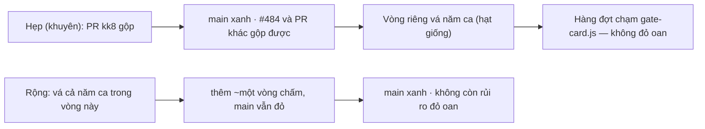

# Thiết kế: kk8-do-khong-rut-merge-base

Gốc: acceptance-gate-kit/_acceptance/khoi-khuon-tren-the-cong/

## Vấn đề

CI `tests` trên `main` đỏ từ khi PR #483 (`khoi-khuon-tren-the-cong`) gộp ở `ed44c2b8`: run 41763815977, «965 passed, 1
failed», ca `FAIL: [KK-8-do] bản tiêm không cho lỗi «lệnh khối KHUON-S1 không ghi lựa chọn» (lỗi: không có)`. `tests` là
check bắt buộc của nhánh chính, nên mọi PR bị chặn (PR #484 là ca đầu).

Gốc rễ đã đo: `tests/scripts/khoi-khuon-tren-the-cong.test.mjs` dựng bản «trước vòng» từ `git merge-base HEAD
origin/main` ở hai chỗ. Trước khi #483 gộp, điểm ấy còn vật cũ. Sau khi gộp, nó đã mang vật của vòng:

- **KK-8-do** chép «khối KHUON-S1 cũ» từ merge-base vào bản sao. Nay khối đó trùng bản gốc, nên bản tiêm là bản lành, và
  ca đỏ không đỏ được → FAIL.
- **`banGocVong()`** (KK-1 và ca so thẻ của KK-5) so «bằng từng byte bản KH1» với bản archive ở merge-base. Nay đó là
  chính vật, nên phép so tự so với chính nó → xanh rỗng (không ai thấy).

## Bản sửa

Năm commit, chỉ chạm tệp test trên. Hai commit cuối đáp phản biện context sạch (gap-probe P1/P2):

4. `cf0a1438` (đỏ có chủ đích) → 5. `dcaf055d`: ca KK-0-mot-moc giữ tệp không còn lời gọi `git merge-base` nào, nên mọi
   bản so phải đi qua `banGocVong`; KK-0-mot-moc-do tiêm một lời gọi vào văn tệp và đòi bộ đếm thấy đúng 1. Ca
   KK-0-dot-bien chạy THẬT hai mutant gỡ chốt («trùng vật», «không đổi gì») trên bản sao tệp, sau khi bản sao nguyên vẹn
   xanh. Chiều đỏ của hai chốt vì thế nằm trong bộ kiểm, không chỉ trong lời kể.

Ba commit đầu:

1. `359868b1` (cherry-pick `ad00a4db` của phiên điều phối): bản tiêm KK-8-do tự sinh từ vật (gỡ dòng `--nhom '<nhóm>'`
   khỏi khối KHUON-S1); bản KH1 ghim cứng `0f734a69` (main ngay trước #483), thiếu commit thì nổ.
2. `305db2fa`: bốn ca mới, đỏ có chủ đích — chiều đỏ đứng trước vật trong lịch sử.
3. `0ca2325e`: biến hai bất biến từ lời chú thích thành vật-máy-giữ:
   - `banGocVong(mốc = KH1)` nổ «không có trong kho» khi mốc vắng, và nổ «trùng vật» khi `scripts/design-floor-khuon.mjs`
     ở mốc có cùng băm với tệp đang kiểm (đúng hình dạng merge-base sống sau khi vòng gộp).
   - `tiemBoNhom(văn)` nổ «bản tiêm không đổi gì» khi nhát tiêm không đổi byte nào (hình dạng của chính lỗi CI).
   - Ca KK-0-goc / KK-0-goc-do / KK-8-tiem / KK-8-tiem-do: lành và đỏ trên cùng vật, thông điệp ghim.

Vì sao ghim sha thay vì khuôn «commit gộp PR» (`merge-base m^1 m^2`) dùng ở can-cu-s1, dieu-phoi: «bản KH1» ở đây là một
phiên bản CỐ ĐỊNH có tên (hồ sơ khuon-loi), không phải «gốc của vòng hiện tại». Ghim sha nói đúng nghĩa ấy. Vòng sau đổi
đầu ra của `--nap` không cờ thì ca đỏ, và đó là đỏ đúng: AC-1 của khoi-khuon hứa tương thích với KH1.

Đã đo độ nhạy bằng hai mutant trên bản sao cạnh tệp thật: gỡ chốt «trùng vật» → `FAIL: [KK-0-goc-do] mốc trỏ HEAD không
nổ đúng thông điệp`; gỡ chốt «không đổi gì» → `FAIL: [KK-8-tiem-do] tiêm rỗng không nổ đúng thông điệp`.

## Quét theo LỚP (CLAUDE.md «sửa theo LỚP»)

Hai lệnh quét, chạy ở HEAD của nhánh vòng (sau commit `dcaf055d`):

```
# A — mọi dòng không phải chú thích nhắc merge-base: 79 dòng ở 23 tệp
grep -rn 'merge-base' tests/ | grep -v '/fixtures/' | grep -Ev '^\S+:\s*[0-9]+:\s*(//|#)'
# B — hình dạng lấy bản cũ không qua merge-base: 7 dòng ở 5 tệp
grep -rnE "origin/main:|show origin/main|rev-parse origin/main|HEAD~[0-9]+:" tests/ | grep -v '/fixtures/'
```

Mỗi tệp trong đầu ra có đúng một nhãn. Một tệp nhiều dòng là vì chuỗi thông điệp và tên ca cũng chứa chữ ấy:

| Nhãn | Tệp (số dòng A) |
|---|---|
| **cùng lớp, chưa vá** | `design-floor/moc-s0-s1.mjs` (1) · `dieu-phoi/mo-dot.test.mjs` (3) · `dieu-phoi/doi-tai-khoan.test.mjs` (2) · `scripts/khuon-loi.test.mjs` (1) · `scripts/lo-trinh-du-lieu-ngay.test.mjs` (3) |
| **đã có khuôn chống** (commit gộp PR, sha ghim, hay ca `merge-base-song` đỏ) | `dieu-phoi/trong-dot.test.mjs` (8) · `dieu-phoi/dp7-chieu-im.mjs` (3) · `dieu-phoi/sua-truoc-dot-thu.test.mjs` (2) · `dieu-phoi/on-dinh-r2.test.mjs` (2) · `dieu-phoi/lop-mod.test.mjs` (9) · `dieu-phoi/dp8-crm-that.mjs` (13, sha crm ghim) · `scripts/can-cu-s1.ca.mjs` (4) |
| **cùng hình dạng, kết quả không phụ thuộc bản cũ** | `dieu-phoi/tiep-tuc.test.mjs` (5; DP3-11-do là ca đỏ merge-base-song) |
| **đo diff đang làm** (trên main rỗng là đúng) | `plugins/run-tests.sh` (3: P150, P161-E10, mốc sha 04d3413) · `scripts/additive-only.test.mjs` (1) · `scripts/kiem-ban-cai.ca.mjs` (1) |
| **kho fixture tạm / chuỗi trong ca** | `scripts/duong-nen.test.mjs` (4) · `scripts/s4-args-main-branch.test.mjs` (5) · `scripts/yaml-chuan.test.mjs` (2) · `scripts/ho-so-da-ky-giu-tuoi.test.mjs` (1) · `scripts/ra-soat-lo-trinh.test.mjs` (2) · `scripts/ghi-boi-tac-tu-cham.test.mjs` (1) · `scripts/tin-hieu.test.mjs` (1, `--is-ancestor`) · `workflows/baseline-tran-bo-qua-don.test.mjs` (2) |

Đầu ra B: `plugins/run-tests.sh:10440–10444` (P196, canh từng PR: tree-hash so với origin/main để buộc tăng version — đo
diff đang làm) · `dieu-phoi/trong-dot.test.mjs:118` và `dieu-phoi/sua-truoc-dot-thu.test.mjs:111` (chú thích của io giả) ·
`scripts/msbv-the.test.mjs:11` (sha ghim). Không chỗ nào cùng lớp.

`scripts/khoi-khuon-tren-the-cong.test.mjs` không còn trong đầu ra A: ca KK-0-mot-moc giữ nó bằng 0.

Ca nghi cùng lớp được đọc ngữ cảnh rồi chạy thực nghiệm. Ca nghi cùng lớp được chạy trên cây thật, rồi chạy trên một bản `clone --shared` có commit «thay đổi hợp lệ của
vòng sau». Kịch bản A: đã gộp, `origin/main` = HEAD. Kịch bản B: một nhánh sau, `origin/main` cũ.

| Chỗ | Ca | Vòng gốc (đã gộp) | Trên main hôm nay | Nhánh sau chạm hợp lệ |
|---|---|---|---|---|
| `tests/design-floor/moc-s0-s1.mjs:314` | THE-M0 | design-floor-moc-s0-s1 (#433) | xanh rỗng | đỏ oan |
| `tests/dieu-phoi/mo-dot.test.mjs:1154` | DP2-11 khong-dot | dieu-phoi-mo-dot-mot-lenh (#298) | xanh rỗng | đỏ oan |
| `tests/dieu-phoi/doi-tai-khoan.test.mjs:819` | DP4-08 khong-ban-giao | dieu-phoi-doi-tai-khoan (#312) | xanh rỗng | đỏ oan |
| `tests/scripts/khuon-loi.test.mjs:524` | KL-8 | khuon-loi (#475) | xanh rỗng | đỏ oan |
| `tests/scripts/lo-trinh-du-lieu-ngay.test.mjs:87` | ND-1-trang-giu, ND-7 | lo-trinh-du-lieu-ngay-du-kien (#368) | xanh rỗng (khai `trungHead` nhưng vẫn PASS) | đỏ oan |

**Câu hỏi cho chủ kho ở Cổng Phạm vi (Hỏi-1, dòng sổ thay d-1): có vá 5 chỗ trên trong vòng này không.** Máy khuyên
không vá. Lý do và giá: hôm nay chúng xanh (rỗng) trên main, nên không chặn PR nào. Vòng
này sinh ra để gỡ chặn `main`, và mỗi chỗ cần khuôn «commit gộp PR» riêng cộng ca `*-do merge-base-song` riêng trên bốn
suite khác nhau. Gộp vào đây thì vòng phình chừng ba lần trong khi mọi PR đang bị chặn. Giá nhận: nhánh sau nào chạm hợp lệ
thẻ cổng (`gate-card.js`), `start-scan`, `tiep-tuc` hay trang lộ trình sẽ gặp đỏ oan ở đúng các ca ấy. Đợt
`nen-thiet-ke-0411` có hàng chạm thẻ cổng, nên rủi ro này gần. Chỗ đi tiếp: hạt giống
`docs/plans/2026-11-04-hat-giong-moc-so-merge-base-song.md`. Khuyến nghị mở vòng riêng ngay sau khi PR này gộp, TRƯỚC
hàng đầu tiên của đợt chạm thẻ cổng.

### Hai lối của Hỏi-1



## Ngoài vật

Không đổi `scripts/`, `lib/`, `feature-loop/`, `skills/` hay hồ sơ đã ký nào. `_acceptance/khoi-khuon-tren-the-cong/`
không bị ghi.
