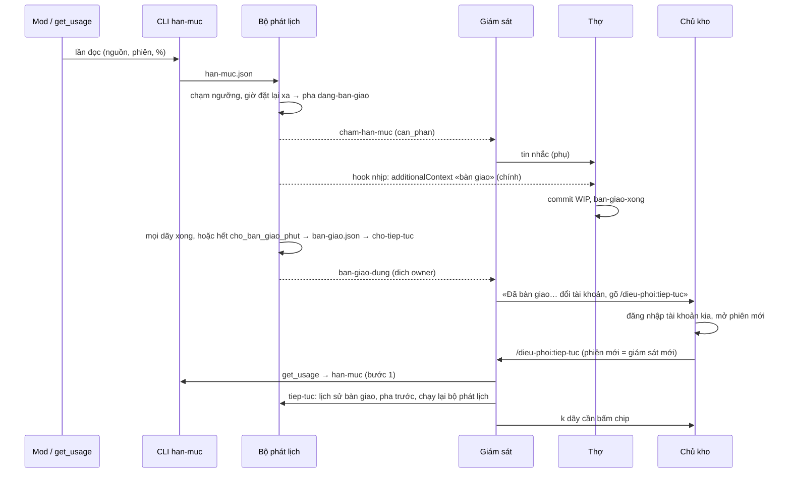

# DP4 `dieu-phoi-doi-tai-khoan` — thiết kế thi công

Gốc: hàng DP4 của lộ trình kit (`docs/plans/lo-trinh-kit.json`) · ô dù
[`dieu-phoi-tho-trong-kit`](../../../_acceptance/dieu-phoi-tho-trong-kit/opportunity.md) (Cổng Đáng build
09/10, phủ DP1–DP4) · **thiết kế chung đã duyệt 10/10:**
[workflow 2026-10-10](2026-10-10-dieu-phoi-workflow-design.md) §3, §4.2 bước 1 và 6, §4.3, §4.5, §6, §8, §11,
§12.1–12.2, §16 (T9, T10, T11) · thiết kế DP3 [2026-10-11](2026-10-11-dieu-phoi-tiep-tuc-mot-lenh-design.md)
(nhịp sống, kế hoạch dãy, lệnh con ghi) · quyết định chủ kho 11/10 về phép đo DP0 (sổ quyết định của hồ sơ,
dòng `by: manh`).

Tài liệu này KHÔNG mở thiết kế lại. Nó chốt chi tiết thi công trong khung đã duyệt và mười hai chỗ chọn mà
spec để ngỏ (mục 3). Chỗ nào spec đã nói thì chỉ trỏ về.

## 1. Việc

Câu giao: «Báo trước khi chạm hạn mức, tự bàn giao nhẹ, tài khoản kia tiếp tục bằng một lệnh — không mất
commit, chữ ký hay quyết định nào». Đúng phần §9 giao cho DP4:

- đọc mức dùng từ ba nguồn vào MỘT tệp `han-muc.json` qua CLI `han-muc` (§4.5), kể cả **mod đọc mức dùng**
  (§12.2);
- bộ phát lịch so mức dùng với hai ngưỡng của đợt: báo trước, tự chờ đặt lại, hoặc tự bàn giao (§4.5);
- hai trạng thái ★ `dang-ban-giao`, `cho-tiep-tuc` trong CÙNG bảng chuyển của DP2 (§3);
- lệnh `/dieu-phoi:ban-giao` và hai lệnh con `ban-giao`, `ban-giao-xong` (§4.3), đồng hồ chờ bàn giao trong
  bộ phát lịch, `ban-giao.json` dựng từ git và thư mục đợt (§6);
- `tiep-tuc` thêm bước 1 (đọc mức dùng) và bước 6 (rời hai trạng thái ★, chuyển bàn giao vào lịch sử) —
  hai bước DP3 đã ghi sổ `descope` để dành cho hàng này;
- hook hạn mức: lưới cuối `StopFailure` (§4.3, T9) và lời nhắc bàn giao qua hook nhịp (T10);
- răng an toàn của lớp mod (T11) đi cùng hàng đầu tiên mang mod, và **khung mod** có marker để DP6 nối vào.

Ca gốc: chủ kho đổi tài khoản giữa đợt crm vì hết hạn mức (09/10); lần đổi 05–06/10 bàn giao tay bằng tệp
nhớ. Đo 11/10 bằng `get_usage`: tài khoản đang dùng 23 % cửa sổ 5 giờ và 12 % cửa sổ tuần.

## 2. Bố cục

```
dieu-phoi/
  commands/ban-giao.md      lệnh người thứ năm: CLI ban-giao → nhắn thợ → chờ → báo câu đổi tài khoản
  commands/tiep-tuc.md      thêm bước đọc mức dùng (trước CLI) và xử lý hai trạng thái ★
  hooks/hooks.json          thêm StopFailure (hook-het-han-muc) và khoá `modules`
  hooks/doc-muc-dung.ts     MOD đọc mức dùng: session.measure → CLI han-muc
  scripts/han-muc.mjs       MỘT bên viết `han-muc.json` (ba bộ chuẩn hoá theo nguồn) + bộ đọc hiệu lực + ngưỡng
  scripts/ban-giao.mjs      lệnh con ban-giao / ban-giao-xong, bước bàn giao (dùng chung với bộ phát lịch)
  scripts/muc-day.mjs       MỘT hàm dựng mục dãy (git + thư mục đợt) cho ban-giao.json và lời ghi danh của tiep-tuc
  scripts/hook-het-han-muc.mjs  lưới cuối StopFailure (T9)
  scripts/mod-luat.mjs      khung mod: bảng sự kiện được phép của từng mod (marker MOD-SU-KIEN) — DP6 nối vào
  scripts/mau/han-muc.json, scripts/mau/ban-giao.json   khuôn hai tệp trao tay mới
  scripts/pha.mjs           thêm hai pha ★ vào bảng; ghi `ban_giao` (mã, pha trước) khi vào pha
  scripts/phat-lich.mjs     nhịp xét hạn mức, chờ đặt lại, đồng hồ bàn giao
  scripts/hook-nhip.mjs     thêm lời nhắc bàn giao (additionalContext) khi pha là đang bàn giao
  scripts/tiep-tuc.mjs      bước 1 và 6; kế hoạch dãy biết phiên đã bàn giao
  scripts/chan-doan.mjs     thêm mục han-muc, ban-giao
  scripts/hinh-dang.mjs     khoá cấu hình `han_muc`
  scripts/the.mjs           thẻ khởi tạo hỏi khẩu vị hạn mức
  scripts/dieu-phoi.mjs     nối lệnh con han-muc, ban-giao, ban-giao-xong
```

Ngoài gói: bảng `COMMAND-NAMES` thêm `/dieu-phoi:ban-giao`; GUIDE §6.6, QUICKSTART nêu lệnh thứ năm;
`CONTEXT.md` thêm «Bàn giao tài khoản» (chữ đã chốt ở spec workflow §15); ca DP2-01 nâng tập lệnh lên năm
(dòng sổ `revisit` ở hồ sơ DP2, như DP3 đã làm). Bộ đo DP0 nằm ở
`_acceptance/dieu-phoi-tho-trong-kit/discovery/do-tai-khoan/thu/` (mục 7).

## 3. Mười hai chỗ chọn (ba chỗ lệch chữ spec, có ghi)

1. **Hai pha ★ vào CÙNG bảng của DP2; một lối vào từ `tam-dung`, một lối ra duy nhất qua `cho-tiep-tuc`.**
   Năm cạnh của DP2 giữ nguyên; thêm sáu: `dang-chay → dang-ban-giao`, `tam-dung → dang-ban-giao`,
   `dang-ban-giao → cho-tiep-tuc`, `cho-tiep-tuc → dang-chay | tam-dung | dang-dong`. Vào pha ghi vào
   `dieu-khien.json` khối `ban_giao: {ma, pha_truoc, vao_luc, ly_do, boi}`; `tiep-tuc` rời pha bằng đường
   `dang-ban-giao → cho-tiep-tuc → <pha_truoc>`. **Lệch chữ spec (hai chỗ):** sơ đồ §3 chỉ vẽ cạnh vào từ
   «đang chạy» — đợt tạm dừng vẫn có thợ làm dở bước (pha tạm dừng chỉ ngừng cấp lượt MỚI) nên vẫn cần bàn giao
   được, và `tiep-tuc` không được tự biến «tạm dừng» thành «đang chạy» (DP3 chỗ chọn 5); sơ đồ còn vẽ cạnh tắt
   `dang_ban_giao → dang_chay` — bỏ, để mọi lối rời đi qua đúng một chỗ dựng và lưu bàn giao (chỗ chọn 10).
   Dòng sổ `descope` có trích dẫn.
2. **`han-muc.json` giữ tối đa 20 lần đọc gần nhất, mỗi lần đã chuẩn hoá.** Một lần đọc:
   `{nguon, phien, luc, cua_so: {five_hour?: {pct, dat_lai}, seven_day?: {pct, dat_lai}}}`. Ba bộ chuẩn hoá,
   một cho mỗi nguồn: `mod` (`kind`, `percentUsed`, `resetsAt` — đúng kiểu `SessionRateLimit` của bản
   2.1.295) · `get-usage` (`label` «5-hour limit» → `five_hour`, «Weekly · all models» → `seven_day`;
   cửa sổ tuần theo từng model bị bỏ, vì §4.5 chỉ xét hai cửa sổ) · `statusline` (`rate_limits.<cửa sổ>`,
   đọc khoan dung `used_percentage`/`percentUsed`, `resets_at` giây hoặc ISO). Đầu vào không ra cửa sổ nào
   → thoát 1, không ghi. Giữ nhiều lần đọc để đo tốc độ đốt (chỗ chọn 4).
3. **Lần đọc hiệu lực** = mới nhất trong các lần đọc tuổi ≤ 35′ (spec §4.5) VÀ (đọc sau `nhan_luc` của giám
   sát hiện tại HOẶC do chính phiên giám sát hiện tại đọc). Vế «hoặc» là chỗ spec để ngỏ: `tiep-tuc` nhận vai
   rồi mới chuyển pha, nhưng bước 1 (đọc mức dùng) đứng TRƯỚC bước nhận vai — lần đọc của chính phiên mới bị
   bỏ oan nếu chỉ so giờ. Số của tài khoản cũ vẫn bị bỏ, vì chúng do phiên khác đọc trước lần nhận vai.
4. **Đường lùi hạ ngưỡng (§4.5) luôn bật, không chờ DP0.** Khi trong 35′ không có lần đọc nào nguồn `mod`,
   ngưỡng bàn giao hiệu lực của một cửa sổ = `max(bao_truoc_pct, ban_giao_pct − tốc_độ_đốt × 30)`, tốc độ
   đốt (điểm/phút) đo từ các lần đọc còn tươi (≤ 35′) của cùng cửa sổ, cùng giờ đặt lại (cần ≥ 2 lần đọc;
   không đo được thì không hạ và khai trong `trang-thai.json`). Nhờ vậy kết quả xấu nhất của DP0 (mod không
   có số) không đổi mã, chỉ đổi lời tài liệu. Mỗi cửa sổ, mỗi giờ đặt lại, bộ phát lịch phát MỘT sự kiện cho
   mức cao nhất mới đạt: `cham-han-muc` thay `gan-han-muc` khi cả hai cùng đạt trong một nhịp.
5. **Chờ đặt lại là trạng thái máy suy, như giảm tải, không phải pha.** Cửa sổ chạm ngưỡng bàn giao mà giờ
   đặt lại còn ≤ `cho_dat_lai_phut` → `trang-thai.json` mang `cho_dat_lai`, bộ phát lịch không cấp lượt mới
   nào, một sự kiện `cho-dat-lai` `can_phan` (giám sát báo chủ kho một dòng, không hỏi). Hết giờ đặt lại và lần
   đọc mới dưới ngưỡng thì tự cấp lại. Không ghi `dieu-khien.json`, để «tạm dừng» vẫn chỉ là chữ của người.
6. **Bộ phát lịch tự vào bàn giao.** Chạm ngưỡng mà giờ đặt lại còn xa → `pha dang-ban-giao` với
   `boi: phat-lich` và sự kiện `cham-han-muc` `can_phan` mang việc `/dieu-phoi:ban-giao`. Thêm một nguồn kích
   hoạt spec chưa nêu: dấu «thợ chết vì hạn mức» mới của hook `StopFailure` (chỗ chọn 11) cũng vào bàn giao —
   tín hiệu mạnh nhất, và là đường duy nhất còn lại khi mọi số mức dùng đã cũ.
7. **Lời nhắc bàn giao đi qua tệp trước, tin sau (T10).** Pha `dang-ban-giao` thì hook nhịp (PostToolUse)
   của phiên trong worktree một dãy chưa báo xong trả `additionalContext`: «Đợt X đang bàn giao: dừng ở ranh
   giới gần nhất, commit WIP, rồi `node <thư mục đợt>/loi/dieu-phoi.mjs ban-giao-xong`». Tối đa một lần mỗi
   5′ mỗi phiên (tệp `ban-giao/nhac/<mã phiên>`). Tin liên phiên của giám sát chỉ để nhắc phiên đang rảnh.
8. **`ban-giao-xong` chỉ đòi cây sạch và hết đơn — không đòi đẩy (T10).** Cây bẩn (`git status --porcelain`
   có dòng) hay còn `xin/<dãy>-*.json` → thoát 1, nêu từng tệp. Dãy đang giữ khoá `s4` → thoát 1, nêu «đang
   xong — chạy lại sau khi lượt chấm hết và nhả khoá»; bước dựng xếp dãy đó «đang xong». Cờ `--wip "<mô tả>"`
   commit hộ bằng `git commit` thường (KHÔNG bỏ hook của kho) với tiêu đề `wip(ban-giao): <mô tả>`. Ghi
   `ban-giao/xong/<dãy>.json`: `{day, ma, luc, nhanh, dinh, da_day, co_wip, phien_cu}`; `phien_cu` là các mã
   phiên có tệp nhịp sống mang worktree của dãy lúc báo xong.
9. **Một hàm dựng mục dãy** (`muc-day.mjs`) cho `ban-giao.json` và lời ghi danh của `tiep-tuc`: hàng (mã),
   slug, trạng thái hồ sơ trong worktree, nhánh, đỉnh, đã đẩy, có commit WIP, «chấm lại cùng round» (dãy giữ
   khoá `s4` lúc dựng và hồ sơ đang `implemented`), việc chờ người, và trạng thái bàn giao `xong` · `dang-xong`
   · `do` · `nghi` · `worktree-mat`. Mọi trường suy từ git và thư mục đợt; không có trường nào cho model điền.
10. **Đồng hồ bàn giao và bước dựng là MỘT hàm (`buocBanGiao`)**, gọi từ nhịp bộ phát lịch và từ CLI
    `ban-giao`. Trong pha `dang-ban-giao`: mọi dãy (trừ nghỉ, worktree mất) đã `xong` hoặc `dang-xong`, HOẶC đã
    quá `cho_ban_giao_phut` kể từ `vao_luc` → dựng `ban-giao.json` (dãy chưa xong ghi `do`). Sau khi dựng, không
    còn khoá `s4` sống (nhịp khoá mới hơn `nhip_cu_phut`) → `pha cho-tiep-tuc` và sự kiện `ban-giao-dung`
    `can_phan` (`dich: owner`) mang câu đổi tài khoản. Mã bàn giao chốt lúc vào pha, nên dựng lại nhiều lần
    vẫn một mã. Đồng hồ ở bộ phát lịch vì nó không tốn hạn mức (§4.3). Đợt không khai `han_muc` vẫn có đồng
    hồ, hạn mặc định 20′ — bàn giao tay không được treo vì một dãy chết không bao giờ báo xong. `tiep-tuc` gọi
    hàm này ở dạng **cưỡng bức** (§4.2 bước 6 «hoàn tất bàn giao trước»): dựng ngay, dãy chưa xong ghi `do`,
    dãy giữ khoá `s4` ghi `dang-xong` và giữ khoá, rồi sang `cho-tiep-tuc` không chờ khoá — người đã có mặt và
    đã chọn tiếp tục. Khi chuyển `ban-giao.json` vào lịch sử, `tiep-tuc` chuyển luôn các dấu `ban-giao/dau/*`
    vào khoá `dau` của bản lịch sử: dấu của tài khoản cũ không kéo đợt vào bàn giao lần nữa (chỗ chọn 6).
11. **Lưới cuối `StopFailure` (T9).** Hook `hook-het-han-muc.mjs`, timeout 60″, chỉ xử `error: "rate_limit"`
    trong worktree của một dãy. Có khoá `s4` hoặc `duong-nen` trỏ worktree đó (trong đợt, chấm chỉ chạy khi
    giữ khoá — hook chặn S4 của DP1) → KHÔNG commit, dấu `luot_do: true`. Không khoá, cây bẩn → `git add -A`
    + `git commit` thường, tiêu đề `wip(ban-giao): lưới cuối — rate_limit <giờ>`; commit lỗi (hook của kho
    từ chối) → dấu ghi dòng đầu stderr, cây giữ nguyên. Ghi `ban-giao/dau/<dãy>.json` và sự kiện
    `tho-het-han-muc` `can_phan`. Lỗi khác (`overloaded`, `server_error`…) → im.
12. **Kế hoạch dãy biết phiên đã bàn giao.** Bàn giao gần nhất (đang mở, hoặc mục mới nhất trong
    `ban-giao/lich-su/`) có `xong/<dãy>` → nhịp sống của các phiên trong `phien_cu` KHÔNG tính là phiên sống
    của dãy, nên dãy ra `mo-chip` (kèm `da_ban_giao: true`) dù nhịp cũ chưa quá 10′. **Lỗ thật nếu không có
    chỗ này:** chủ kho đổi tài khoản trong vòng 10′ sau lời gọi công cụ cuối của thợ thì `tiep-tuc` (DP3) thấy
    dãy «còn phiên sống», trả `khong`, và dãy đứng tới lần chạy sau. Thân lệnh dặn: không đổi tài khoản mà
    phiên cũ của dãy còn trong nhóm thanh bên → nhắn phiên đó «tiếp tục» thay vì mở chip.

Ba chỗ ngoài danh sách vẫn theo chữ spec: `tiep-tuc` đòi một lần đọc hiệu lực CỦA CHÍNH PHIÊN GỌI trước khi
rời hai pha ★, và mức dùng vượt `bao_truoc_pct` thì không rời, khuyên chờ kèm giờ đặt lại (§4.2 bước 1, 6);
và hai nhịp đọc đều đặn của §4.5 — giám sát gọi `get_usage` rồi `han-muc` MỖI LẦN THỨC (nên dạng `--nhe` của
`tiep-tuc.md` có bước đọc mức dùng, khác dạng nhẹ của DP3), và việc của lịch 30′ gọi `get_usage` rồi `han-muc`
trước `danh-thuc`. `chan-doan` thêm mục `han-muc` (`thieu` khi đợt khai `han_muc` mà không có lần đọc hiệu lực)
để nhịp này không hỏng im: thiếu nó thì nhánh M2 (mod không có số) mù hạn mức sau 35′.

## 4. Tệp trao tay mới (khuôn ở `dieu-phoi/scripts/mau/`)

| Tệp | Bên viết | Bên đọc | Khuôn |
|---|---|---|---|
| `han-muc.json` | CLI `han-muc` | bộ phát lịch, `chan-doan`, `tiep-tuc` | `{doc: [lần đọc]}` — chỗ chọn 2 |
| `ban-giao.json` | `buocBanGiao` (CLI `ban-giao`, bộ phát lịch) | `tiep-tuc`, lời ghi danh | `{ma, trang_thai, dot, luc, vao_luc, ly_do, boi, sha_nhanh_chinh, day[], khoa[], don[]}` |
| `ban-giao/xong/<dãy>.json` | CLI `ban-giao-xong` | `buocBanGiao`, kế hoạch dãy | chỗ chọn 8 |
| `ban-giao/dau/<dãy>.json` | hook `StopFailure` | bộ phát lịch, `muc-day` | `{day, phien, luc, loi, wip, luot_do, loi_commit?}` |
| `ban-giao/lich-su/<mã>.json` | `tiep-tuc` | người soát, kế hoạch dãy | `ban-giao.json` với `trang_thai: da-tiep-tuc`, `tiep_tuc_luc`, `tiep_tuc_boi`, `dau` (các dấu đã chuyển) |
| `ban-giao/nhac/<mã phiên>` | hook nhịp | hook nhịp | tệp rỗng, mtime là lần nhắc cuối |
| `dieu-khien.json` (thêm) | `pha` | mọi bên | khối `ban_giao` — chỗ chọn 1 |

Khoá cấu hình mới `han_muc` của `dieu-phoi.config.json`: `{bao_truoc_pct, ban_giao_pct, cho_ban_giao_phut,
cho_dat_lai_phut}`. Khuôn đợt mang đề xuất của máy `80 · 90 · 20 · 45`; số thật là khẩu vị rủi ro của chủ kho,
duyệt ở thẻ khởi tạo của từng đợt (T15 — `hoi` thêm `khau-vi-han-muc`). Đợt không khai khoá (đợt crm đang
chạy) → bộ phát lịch không xét hạn mức: đường đọc-cũ, không bắt migrate.

## 5. Luồng một lần đổi tài khoản



## 6. Nhánh DP0 (spec §11) — chốt khi có `ket-qua.md`

Mã ở mục 3 đúng cho MỌI nhánh dưới đây; nhánh chỉ đổi điều tài liệu nói và giới hạn đã khai. Bảng ánh xạ
nằm ở hợp đồng (mục «Nhánh DP0»), ca `DP4-15` đối chiếu nó với `ket-qua.md`.

| Câu | Nhánh khi «còn» | Nhánh khi «mất» / «khác» | Khi «chưa-đo» |
|---|---|---|---|
| 1 · phiên cũ, nhóm, lịch 30′ sau khi đổi | tài liệu: phiên cũ nhắn được → `tiep-tuc` dặn nhắn trước khi mở chip | tài liệu: dựng lại nhóm và lịch là bước thường của `tiep-tuc` | giới hạn khai, ngưỡng: đợt thử crm |
| 2 · `rate_limits` của dòng trạng thái | nguồn thứ ba có thật, tài liệu nêu lệnh dòng trạng thái tuỳ chọn | bộ chuẩn hoá `statusline` giữ (vô hại), tài liệu không nêu nguồn này | như «mất» |
| 3 · `StopFailure` với `rate_limit` | lưới cuối đã chứng trên máy | lưới cuối vẫn giữ, khai «chưa thấy bắn» | khai giới hạn, ngưỡng: ≥1 thợ chết vì hạn mức trong đợt thử mà không có dấu |
| 5 · gói và hook nạp sau khi đổi | tài liệu: `/dieu-phoi:tiep-tuc` có sẵn | câu báo bàn giao luôn kèm đường lùi CLI `node <thư mục đợt>/loi/dieu-phoi.mjs tiep-tuc` (mã giữ cho mọi nhánh) | khai, ngưỡng: lần đổi đầu sau khi crm cài gói |
| 6 · `rateLimits` của mod | mod là nguồn số 1 | `get_usage` là nguồn chính, đường lùi hạ ngưỡng gánh (chỗ chọn 4) | như «mất» |

Câu 4 không thuộc DP0 nữa: hồ sơ DP3 khai nó là giới hạn (ngưỡng đợt thử crm), và ngày 11/10 một tin liên
phiên tới phiên «Điều phối M5» đang rảnh nhận kết quả «delivered — its turn has started» — một quan sát cùng
tài khoản, cùng máy, ghi vào `ket-qua.md`.

## 7. Bộ đo DP0 (chuẩn bị, chưa cài)

`discovery/do-tai-khoan/thu/`: `ghi-stdin.mjs` (ghi stdin ra một tệp, in một dòng ngắn) · `cai.mjs`
(cài ba thử nghiệm đã được chủ kho đồng ý, mỗi cái MỘT chỗ: h — `statusLine` trong
`.claude/settings.local.json` của MỘT worktree thử; i — hook `StopFailure` cùng tệp đó; l — mod thử chép vào
thư mục mod của MỘT phiên đo; sao lưu tệp gốc và ghi `da-cai.json`) · `go.mjs` (khôi phục đúng tệp gốc, xoá mod
thử) · `doc.mjs` (gom tệp đã ghi thành bảng số để so với `get_usage`). `cai.mjs` chỉ chạy khi Điều phối chọn
giờ đo; viết mod vào thư mục mod bật câu hỏi nạp lại nóng cho chủ kho, nên KHÔNG làm lúc thiết kế.

Câu 2 và 6 không cần đổi tài khoản: đo được ngay khi h và l đã cài (so với `get_usage` cùng lúc). Câu 1 và 5
cần lần đổi. Câu 3 cần một lượt thật sự cạn hạn mức — lần đổi chủ động không cạn, nên nhiều khả năng ở lại
«chưa-đo».

## 8. Đo

Ca của hàng sống ở `tests/dieu-phoi/doi-tai-khoan.test.mjs` (tên ca «DP4-…»): kho thử do mã sinh, đường suy từ
vị trí tệp, đồng hồ giả qua tham số và `DIEU_PHOI_NOW_MS`. Mỗi phép đo mới có cặp hai chiều trên cùng
fixture. Round-trip: CLI `han-muc` thật ghi → nhịp bộ phát lịch thật đọc; `buocBanGiao` thật ghi
`ban-giao.json` → `tiep-tuc` thật đọc; hook thật (lệnh rút từ `hooks.json`) → bộ đọc thật. Mod đo bằng
`claude plugin test` trên bản sao gói (bản Claude Code có lệnh `test`); răng an toàn đo bằng
`claude plugin validate --strict --json` cộng quét nguồn. `rateLimits` của ca mod và đầu vào nguồn `mod` của
ca CLI rút từ MỘT tệp fixture chung, và argv mod gọi được chạy thật bằng CLI `han-muc` (round-trip mod → CLI). Suite DP1–DP3 xanh nguyên tên, trừ ca tập lệnh.

## 9. Giới hạn đã khai

- Quét «mod không bao giờ trả cho phép» là quét CHỮ: một nhánh dựng chữ `allow` lúc chạy (ghép chuỗi) lọt.
  Bù: bảng sự kiện được phép theo mod — mod đọc mức dùng không được nghe sự kiện cổng nào, nên nó không có
  chỗ để trả lời cho phép. Ngưỡng mở lại: DP6 thêm mod nghe sự kiện cổng.
- `claude plugin test` chỉ có ở bản Claude Code có lệnh `test` (máy M5: bản 2.1.295 của app; CLI trên PATH
  2.1.281 không có). CI không có Claude Code: hai eval mod chạy ở lượt chấm trên máy, như eval validate của DP1.
- Bàn giao không chứng được việc của app (nhắn thợ, đẩy thông báo, đăng nhập): suite đo CLI và hook; lệnh người
  làm việc của app.
- Tài khoản không có mã trong mod hay `get_usage`: «số của tài khoản cũ» nhận ra qua phiên đọc và giờ nhận vai
  (chỗ chọn 3). Phiên của tài khoản cũ còn chạy SAU khi đổi mà vẫn đọc số thì lọt. Ngưỡng: DP0 câu 1 «phiên cũ
  còn chạy».
